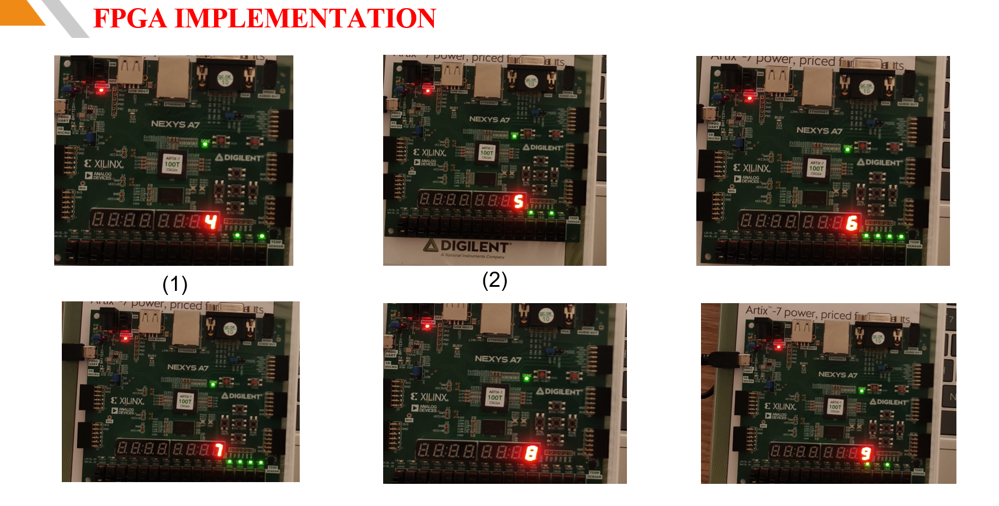

# 5-Stage RISC-V Pipeline Core

A synthesizable Verilog implementation of a 32-bit, five-stage RISC-V pipeline on a Digilent Nexys A7 FPGA. The design implements an RV32I subset and includes forwarding, load-use hazard handling, control-hazard flushing, branch/jump resolution, and separate instruction and data memories.



## Features

- 32-bit RISC-V datapath
- Five pipeline stages: Instruction Fetch, Instruction Decode, Execute, Memory, and Write Back
- RV32I subset:
  - `R-type`: `ADD`, `SUB`, `AND`, `OR`
  - `I-type`: `ADDI`, `LW`
  - `S-type`: `SW`
  - Branch: `BEQ`
  - Jump: `JAL`
- EX-to-EX and MEM-to-EX operand forwarding
- Register-file write-through for same-cycle write-back bypass
- Load-use detection with pipeline stalls
- Taken branch/JAL flushing of IF/ID and ID/EX
- `x0` enforced as a zero register
- 32-word instruction memory and 32-word data memory
- Automatic zero-initialized instruction-memory NOP fill

## Repository Contents

| File | Description |
| --- | --- |
| `riscv_pipeline_top.v` | Top-level core wrapper, instruction/data memories, and all pipeline submodules |
| `tb_riscv_pipeline_top.v` | Verilog testbench with clock generation and register/memory assertions |
| `nexys_a7.xdc` | Example Nexys A7 pin and 100 MHz clock constraints |
| `instructions.hex2` | Hex encoding of the six-instruction test program |
| `simulation.png` | Behavioral simulation waveform |
| `FPGA_impl.png` | Photographs of the implementation on the Nexys A7 board |
| `instrustion_details.png` | Test-program instruction and write-back reference table |

## Architecture

```text
Instruction Memory
        |
        v
IF  ->  ID  ->  EX  ->  MEM  ->  WB
        |      |       |         |
        |      |       |         +-- Register File
        |      |       +------------ Data Memory
        |      +-------------------- Forwarding Unit
        +--------------------------- Hazard Unit
```

### Pipeline Stages

1. **IF - Instruction Fetch**
   - Updates the program counter
   - Fetches the instruction at `PC[6:2]`
   - NOPs are returned for addresses outside the 128-byte instruction memory

2. **ID - Instruction Decode**
   - Decodes the opcode and control signals
   - Reads source operands from the register file
   - Generates I-, S-, B-, and J-type immediates

3. **EX - Execute**
   - Performs ALU operations
   - Resolves forwarding from EX/MEM and MEM/WB
   - Resolves taken branches and JAL redirects
   - Writes `PC + 4` for JAL

4. **MEM - Memory**
   - Reads or writes the 32-word data memory
   - Exposes `mem_addr`, `mem_wdata`, `mem_read`, and `mem_write`

5. **WB - Write Back**
   - Writes load data or ALU results to the register file
   - Exposes the write-back value through `wb_result`

## Included Test Program

The instruction memory is initialized in `riscv_pipeline_top.v` with:

| Address | Hex | Instruction | Expected result |
| ---: | --- | --- | ---: |
| 0 | `00500093` | `addi x1, x0, 5` | `x1 = 5` |
| 4 | `00A00113` | `addi x2, x0, 10` | `x2 = 10` |
| 8 | `002081B3` | `add x3, x1, x2` | `x3 = 15` |
| 12 | `00302023` | `sw x3, 0(x0)` | `mem[0] = 15` |
| 16 | `00002203` | `lw x4, 0(x0)` | `x4 = 15` |
| 20 | `001202B3` | `add x5, x4, x1` | `x5 = 20` |

The testbench stops at `PC = 76` and verifies:

- `x1 = 5`
- `x2 = 10`
- `x3 = 15`
- `x4 = 15`
- `x5 = 20`
- `mem[0] = 15`
- `wb_result = 0`

If the assertions pass, the testbench prints `RESULT: PASS`.

## Top-Level Interface

```verilog
module riscv_pipeline_top (
    input  wire        clk,
    input  wire        reset,
    output wire [31:0] wb_result,
    output wire [31:0] pc_out
);
```

- `clk`: pipeline clock
- `reset`: active-high synchronous reset
- `wb_result`: value entering or present at write-back
- `pc_out`: current instruction address

## Simulation

With Icarus Verilog installed:

```powershell
iverilog -s tb_riscv_pipeline_top -o riscv_pipeline_tb.vvp riscv_pipeline_top.v tb_riscv_pipeline_top.v
vvp riscv_pipeline_tb.vvp
```

With a GUI simulator such as AMD Vivado:

1. Create or open an RTL project.
2. Add `riscv_pipeline_top.v` and `tb_riscv_pipeline_top.v`.
3. Set `tb_riscv_pipeline_top` as the top module for simulation.
4. Run behavioral simulation.

The repository is expected to produce a waveform similar to [simulation.png](simulation.png).

## FPGA Synthesis

1. Create a new Vivado RTL project for a Digilent Nexys A7 board.
2. Add `riscv_pipeline_top.v` as a design source.
3. Add `nexys_a7.xdc` as a constraints source.
4. Add the appropriate Nexys A7 board wrapper or remap the top-level ports to the board pins.
5. Run synthesis, implementation, and generate a bitstream.
6. Program the board.

> **Integration note:** `riscv_pipeline_top.v` exposes `clk`, `reset`, `wb_result[31:0]`, and `pc_out[31:0]`. The included XDC uses board names such as `CLK100MHZ`, `btnC`, `sw0`, and `LED[0:15]`; those names require a board wrapper or matching top-level ports before synthesis.

For example, a Nexys A7 wrapper can map:

- `CLK100MHZ` to the core `clk`
- `btnC` to the core `reset`
- Core `wb_result` or `pc_out` bits to LEDs

## Memory Organization

### Instruction Memory

- 32 entries of 32 bits
- Addressable range: 128 bytes
- Byte address is converted with `addr = pc_out[6:2]`
- All uninitialized entries are `0x00000013` (`NOP`)
- Instructions outside the top-level 128-byte range are also converted to NOP

### Data Memory

- 32 entries of 32 bits
- Byte address is converted with `addr = mem_addr[6:2]`
- Writes occur on the rising edge
- Reads are combinational when `mem_read` is asserted
- Addresses outside 0-124 bytes share the 32-word address decode range based on `mem_addr[6:2]`

## Simulation and FPGA Results

The supplied results show:

- Correct register values `x1` through `x5`
- `mem[0] = 15`
- Final PC stopping at 76
- `wb_result = 0`
- PASS status in the behavioral testbench
- FPGA LED values corresponding to the write-back sequence

## Limitations

This project is a subset core, not a complete RV32I processor:

- No UART, timer, interrupt, or CSR support
- No instruction/data cache
- No external peripheral interface in the core wrapper
- Instructions are embedded in RTL rather than loaded at runtime
- No byte/halfword load-store support
- Supported arithmetic is limited to ADD, SUB, AND, OR, and ADDI
- Branch support is limited to BEQ
- The core has 32 in-RTL words of data and instruction memory
